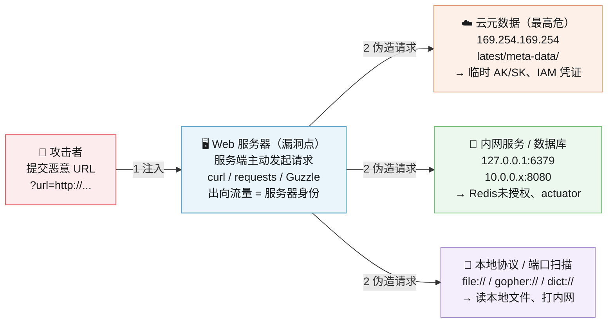

## Overview

In a Server-Side Request Forgery ([SSRF](https://owasp.org/www-community/attacks/Server_Side_Request_Forgery)) attack, the attacker can abuse functionality on the server to read or update internal resources. The attacker can supply or modify a URL which the code running on the server will read or submit data to, and by carefully selecting the URLs, the attacker may be able to read server configuration such as AWS metadata, connect to internal services like http enabled databases or perform post requests towards internal services which are not intended to be exposed.

SSRF（Server-Side Request Forgery，服务端请求伪造）——攻击者诱导服务器代为发起任意请求，从而穿透内网、访问云元数据、打内部服务。

## Description

The target application may have functionality for importing data from a URL, publishing data to a URL or otherwise reading data from a URL that can be tampered with. The attacker modifies the calls to this functionality by supplying a completely different URL or by manipulating how URLs are built (path traversal etc.).

When the manipulated request goes to the server, the server-side code picks up the manipulated URL and tries to read data to the manipulated URL. By selecting target URLs the attacker may be able to read data from services that are not directly exposed on the internet:

- Cloud server meta-data - Cloud services such as AWS provide a REST interface on `http://169.254.169.254/` where important configuration and sometimes even authentication keys can be extracted.
- Database HTTP interfaces - NoSQL database such as MongoDB provide REST interfaces on HTTP ports. If the database is expected to only be available to internally, authentication may be disabled and the attacker can extract data.
- Internal REST interfaces.
- Files - The attacker may be able to read files using `file://` URIs.

The attacker may also use this functionality to import untrusted data into code that expects to only read data from trusted sources, and as such circumvent input validation.

**核心链路**：攻击者注入恶意 URL → 受害服务器代为请求（携带内网信任身份）→ 打到云元数据 / 内网服务 / 本地文件，三类目标危害依次递进。

------

**常用 Payload**

| 场景         | Payload                                                      |
| ------------ | ------------------------------------------------------------ |
| AWS 元数据   | `http://169.254.169.254/latest/meta-data/iam/security-credentials/` |
| GCP 元数据   | `http://metadata.google.internal/computeMetadata/v1/`（需 Header `Metadata-Flavor: Google`） |
| 阿里云元数据 | `http://100.100.100.200/latest/meta-data/ram/security-credentials/` |
| 内网探测     | `http://127.0.0.1:8080/actuator/env`                         |
| Redis 打写   | `gopher://127.0.0.1:6379/_*1%0d%0a$8%0d%0aflushall...`       |
| 读本地文件   | `file:///etc/passwd`                                         |

**WAF / 白名单绕过**

- IP 变形：`127.0.0.1` → `2130706431`（十进制）/ `0x7f000001`（十六进制）/ `0177.0.0.1`（八进制）
- URL 混淆：`http://allowed.com@127.0.0.1/`、`http://[::1]/`、`http://[::ffff:127.0.0.1]/`
- 302 短链跳转：外部可控 redirect → 跳内网
- DNS Rebinding：首次解析公网 IP 通过校验，二次解析 `127.0.0.1`

## Prevention

See the [Server-Side Request Forgery Prevention Cheat Sheet](https://cheatsheetseries.owasp.org/cheatsheets/Server_Side_Request_Forgery_Prevention_Cheat_Sheet.html).

**防御要点**

1. **网络层**：出向防火墙白名单，只允许指定域名/IP 段
2. **协议限制**：仅允许 http/https，禁 `file`/`gopher`/`dict`
3. **解析后校验**：DNS 解析出 IP 后再判是否内网，不能只校验域名字符串
4. **云元数据加固**：AWS 强制 IMDSv2（要求 Token Header）
5. **不自动跟随重定向**：302/301 跟随前重新校验目标 IP
6. **统一出口代理 + 审计**
7. **实例最小权限**：角色不关联高权限 AK/SK

**常见入口**：`?url=`、`?dest=`、`?image=` 参数、webhook 配置、PDF/截图生成、从 URL 导入文件、SSO/OAuth 回调、API 代理转发。测试优先打 `169.254.169.254` 看回显与延迟差异。

**快速识别 SSRF 的入口点**：URL 参数（`?url=`、`?dest=`、`?image=`）、webhook 配置、PDF/截图生成、文件导入（从 URL 拉取）、SSO/OAuth 回调、API 集成代理。测试时先打 `http://169.254.169.254` 看回显/延迟差异，再逐步扩展。